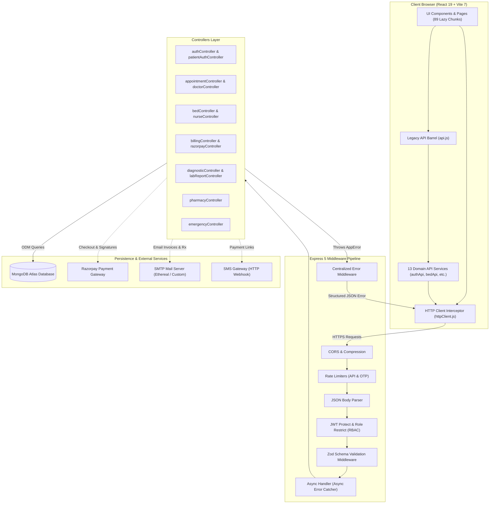

# 🏗️ Nivora Care Hospital Management System — System Architecture

> **Document Version**: 2.0.0  
> **Architecture Style**: Domain-Driven N-Tier Monolith with Micro-Frontends  
> **Status**: Verified Active Architecture  

---

## 1. System Overview & Technology Stack

Nivora Care HMS is built on a modern, typed, event-driven JavaScript stack with an Express.js 5 backend, a MongoDB Atlas persistence layer, and a React 19 single-page application powered by Vite 7.

```
┌────────────────────────────────────────────────────────────────────────┐
│                        CLIENT LAYER (React 19)                         │
│  Vite 7 • React Router 7 • TailwindCSS 3 • Recharts • QR Barcode SDK  │
└───────────────────────────────────┬────────────────────────────────────┘
                                    │ HTTP / JSON (Axios Client)
                                    ▼
┌────────────────────────────────────────────────────────────────────────┐
│                     SERVER APPLICATION LAYER (Node.js)                 │
│  Express 5 • Zod 4 • JWT Auth • AsyncHandler • Compression • Multer    │
└───────────────────────────────────┬────────────────────────────────────┘
                                    │ Mongoose 8 (ODM)
                                    ▼
┌────────────────────────────────────────────────────────────────────────┐
│                        DATA PERSISTENCE LAYER                          │
│               MongoDB Atlas (43 Indexed Domain Models)                 │
└────────────────────────────────────────────────────────────────────────┘
```

### 1.1 Verified Technology Stack & Versions

| Layer | Technology | Version | Purpose / Role in System |
|---|---|---|---|
| **Runtime** | Node.js | v18.0+ | Server-side JavaScript execution environment (ES Modules) |
| **Backend Framework** | Express.js | `^5.1.0` | HTTP application server, routing, and middleware pipeline |
| **Database ODM** | Mongoose | `^8.18.0` | Schema definition, validation hooks, indexes, and queries |
| **Database** | MongoDB | v6.0+ | Document database supporting ACID multi-document transactions |
| **Validation Engine** | Zod | `^4.6.2` | Zero-trust request payload and data boundary validation |
| **Security** | `jsonwebtoken` & `bcryptjs` | `^9.0.2` / `^3.0.2` | Stateless auth tokens and salted password hashing |
| **Rate Limiter** | `express-rate-limit` | `^8.7.0` | Defense-in-depth against DDoS and OTP brute force attacks |
| **Payment Gateway** | Razorpay SDK | `^2.9.8` | Digital payments, order generation, and signature verification |
| **Email Service** | Nodemailer | `^10.0.1` | Automated SMTP tax invoice & digital prescription dispatch |
| **Document Engine** | PDFKit | `^0.20.2` | High-fidelity server-side clinical PDF document generation |
| **Frontend Framework** | React | `^19.1.1` | Declarative user interface with Suspense and Error Boundaries |
| **Bundler & Tooling** | Vite | `^7.1.3` | Ultra-fast HMR development server and Rollup production bundler |
| **Client Routing** | React Router DOM | `^7.8.2` | Client-side routing with nested role layouts |
| **Styling** | TailwindCSS | `^3.4.17` | Utility-first responsive design tokens and CSS custom variables |
| **Visual Analytics** | Recharts | `^3.10.1` | Hospital KPI dashboards, revenue trends, occupancy charts |
| **Barcode & QR** | `qrcode` & `html5-qrcode` | `^1.5.4` / `^2.3.8` | ABHA card generation and live camera QR scanning |
| **Testing Engine** | Vitest | `^5.0.0` | Fast unit and integration testing runner (Server & Client) |

---

## 2. High-Level Architecture Diagram



---

## 3. Frontend Architecture

### 3.1 Directory Structure
```
client/src/
├── __tests__/                   # Client Vitest suites (doctorName, printService, login)
├── components/
│   ├── common/
│   │   └── ErrorBoundary.jsx    # Top-level React Error Boundary with fallback UI
│   ├── ui/                      # Standardized Design System components
│   │   ├── Modal.jsx            # Adaptive Apple-style bottom sheet (<md) & centered dialog (>=md)
│   │   ├── ActionDropdown.jsx   # Accessible context menu for compact table actions
│   │   ├── SidebarCollapseButton.jsx # Accessible sidebar toggle (Ctrl+B / click)
│   │   ├── ConfirmDialog.jsx    # Accessible modal replacing window.confirm()
│   │   ├── PageHeader.jsx       # Standardized page title, badge & action button
│   │   ├── DataTable.jsx        # Sortable, searchable, paginated data table
│   │   ├── EmptyStateCard.jsx   # Empty state placeholder
│   │   ├── PageLoader.jsx       # Suspense fallback loading indicator
│   │   └── SkeletonTable.jsx    # Animated loading table skeleton
│   ├── mobile/                  # Native mobile ergonomics
│   │   ├── MobileBottomNav.jsx  # Floating touch bottom bar with role-tailored tabs
│   │   ├── MobileMenuSheet.jsx  # Slide-out drawer with real-time search & chips
│   │   └── MobileNavIcons.jsx   # Featherweight SVG iconography for touch navigation
│   ├── DashboardLayout.jsx      # Staff portal navigation shell (sidebar + safe-area header)
│   ├── PatientLayout.jsx        # Patient portal navigation shell
│   ├── ProtectedRoute.jsx       # Staff JWT route guard with role checks
│   └── PatientProtectedRoute.jsx# Patient session route guard
├── config/
│   └── env.js                   # Validated client env (apiBaseUrl, razorpayKeyId)
├── context/
│   ├── AuthContext.jsx          # Staff authentication state (user, token, login, logout)
│   ├── PatientAuthContext.jsx   # Patient authentication state
│   └── PrintModalContext.jsx    # Universal print modal state provider
├── pages/                       # 89 portal and operational screens (lazy-loaded)
│   ├── admin/                   # 17 Executive administration screens
│   ├── diagnostic/              # 18 Pathology & Radiology screens
│   ├── doctor/                  # 8 Outpatient & Clinical consultation screens
│   ├── emergency/               # 6 Emergency triage & ER management screens
│   ├── nurse/                   # 12 Inpatient monitoring & nursing station screens
│   ├── patient/                 # 26 Patient self-service portal screens
│   ├── pharmacy/                # 17 Medication inventory & dispensing screens
│   └── reception/               # 10 Front desk, waiting room & calendar screens
├── services/                    # Domain API service modules
│   ├── httpClient.js            # Axios instance with auth & cleanRepeatedDr interceptors
│   ├── api.js                   # Backward-compatible re-export barrel (200+ exports)
│   ├── authApi.js               # Staff authentication requests
│   ├── patientApi.js            # Patient directory & registration
│   ├── doctorApi.js             # Doctor directory, schedule & leaves
│   ├── appointmentApi.js        # Appointment booking & status lifecycle
│   ├── billingApi.js            # Invoices, charges, payment link dispatch
│   ├── prescriptionApi.js       # Rx authoring, email delivery, eMAR logging
│   ├── bedApi.js                # Ward occupancy, bed allocation & transfer
│   ├── vitalsApi.js             # Inpatient & pre-consultation vitals
│   ├── labReportApi.js          # Diagnostic investigations & lab tests
│   ├── notificationApi.js       # Real-time staff notifications
│   ├── nurseApi.js              # Nursing tasks, notes, handovers & intake/output
│   ├── adminApi.js              # Staff management, departments, audit logs
│   ├── receptionApi.js          # Front desk queue, token allocation, reminders
│   ├── pharmacyApi.js           # Dispensing queue, inventory, batches, suppliers
│   ├── diagnosticApi.js         # Phlebotomy samples, lab workbenches, PACS DICOM
│   └── emergencyApi.js          # Emergency queue, trauma encounters, ER beds
├── utils/                       # Common utilities (doctorName, printService, csvExport)
├── App.jsx                      # Route definitions with lazy loading & Suspense
├── index.css                    # Tailwind CSS custom design tokens, safe areas & animations
└── main.jsx                     # Root React entry point wrapped in ErrorBoundary
```

### 3.2 Dual Authentication Trees
The client router employs two completely separated authentication contexts:
1. **Staff Tree** (`<ProtectedRoute>`): Checks `localStorage.getItem("token")`. Enforces role permissions and wraps views inside `<DashboardLayout>` (Sidebar with role-based navigation links).
2. **Patient Tree** (`<PatientProtectedRoute>`): Checks `localStorage.getItem("patientToken")`. Wraps views inside `<PatientLayout>` (Patient-tailored navigation bar).

### 3.3 Mobile & Tablet Responsive Architecture
The client interface implements Apple Human Interface Guidelines and Emil Kowalski design engineering principles:
1. **Safe-Area Inset Handling**: `viewport-fit=cover` ensures full screen edge-to-edge rendering. Top headers utilize `padding-top: max(0px, env(safe-area-inset-top, 0px))` to avoid iPhone Dynamic Islands, and mobile content reserves `pb-[calc(4rem+max(env(safe-area-inset-bottom,0px),8px))]` to clear fixed bottom navigation.
2. **Breakpoint Partitioning (`md: 768px`)**:
   - **Phone (`< md`)**: Compact header, bottom touch navigation bar (`<MobileBottomNav />`), edge swipe drawer (`<MobileMenuSheet />`), and bottom sheet dialogs (`<Modal />`).
   - **Tablet / iPad Portrait (`md: 768px - 1024px`)**: Automatically transitions to the desktop-class docked sidebar layout (`md:w-56`), hiding the mobile bottom bar and rendering centered glass modals.
   - **Desktop (`>= 1024px`)**: Full-width sidebar (`lg:w-64`) with collapsible width (`Ctrl+B` toggle) and multi-column clinical workbenches.
3. **Adaptive Table-to-Card Pattern**: Clinical tabular views automatically pivot to stacked touch cards on small viewports (`< md`), presenting complete patient context without horizontal scrolling.
4. **Direct-Manipulation Edge Swipe**: Touch listeners detect rightward swipes initiated within 28px of the left screen edge, fluidly opening navigation drawers.
5. **Interruptible Transitions**: Navigation sheets and drawers remain mounted with `pointer-events-none` when closed, guaranteeing smooth 60fps hardware-accelerated exit animations.

---

## 4. Backend Architecture

### 4.1 Request Processing Pipeline
Every incoming HTTP request to the Express server flows through a strict, deterministic sequence:

```
1. cors()                   → Enforces Allowed Origins
2. compression()            → Gzip/Brotli payload compression
3. express.json()           → Parses JSON request body
4. apiLimiter               → Tiered IP rate limiting (100 req/min)
5. Route Matcher            → Maps URL to domain router (/api/...)
6. protect                  → Validates Bearer JWT header & loads user
7. restrictTo(...)          → Enforces RBAC permissions against user.role
8. validate(schema)         → Validates req.body using Zod schema
9. asyncHandler(fn)         → Executes controller logic, catches rejections
10. errorHandler            → Centralized error middleware formats response
```

### 4.2 Centralized Environment Configuration
Located in [`server/config/env.js`](file:///c:/Users/priya/OneDrive/Documents/Default%20Project/Hospital-Management-System/server/config/env.js):
- Validates mandatory environment variables (`MONGO_URI`, `JWT_SECRET`) on server startup.
- Halts execution with an informative diagnostic message if mandatory keys are missing.
- Exposes a frozen, immutable `env` singleton preventing accidental runtime mutations.

### 4.3 Error Handling Architecture
- **`AppError`** ([`server/utils/AppError.js`](file:///c:/Users/priya/OneDrive/Documents/Default%20Project/Hospital-Management-System/server/utils/AppError.js)): Custom operational error subclassing `Error` with `statusCode`, `status`, and `isOperational = true`.
- **`asyncHandler`** ([`server/middleware/asyncHandler.js`](file:///c:/Users/priya/OneDrive/Documents/Default%20Project/Hospital-Management-System/server/middleware/asyncHandler.js)): Higher-order route wrapper catching rejected promises and piping them to `next(error)`.
- **`errorMiddleware`** ([`server/middleware/errorMiddleware.js`](file:///c:/Users/priya/OneDrive/Documents/Default%20Project/Hospital-Management-System/server/middleware/errorMiddleware.js)): Centralized error handler converting Mongoose CastError, ValidationError, Duplicate Key (11000), and JWT errors into clean HTTP responses.

---

## 5. Database Architecture & Key Domain Models

The persistence layer consists of **43 Mongoose models** optimized with compound and unique indexes.

### 5.1 Core Domain Entity Relationships

```mermaid
erDiagram
    PATIENT ||--o{ APPOINTMENT : books
    PATIENT ||--o{ PRESCRIPTION : receives
    PATIENT ||--o{ BILLING : billed_for
    PATIENT ||--o{ VITALS : tracks
    PATIENT ||--o{ DIAGNOSTIC_ORDER : undergoes
    PATIENT ||--o? BED : occupies

    DOCTOR ||--o{ APPOINTMENT : attends
    DOCTOR ||--o{ PRESCRIPTION : authors
    DOCTOR ||--o{ CLINICAL_NOTE : writes
    DOCTOR ||--o{ DIAGNOSTIC_ORDER : orders

    BED }o--|| WARD : located_in
    BED ||--o{ BED_HISTORY : tracks_stays

    BILLING ||--o| APPOINTMENT : settles_visit
    BILLING ||--o| BED : includes_bed_tariff

    DIAGNOSTIC_ORDER ||--o{ DIAGNOSTIC_SAMPLE : produces
    DIAGNOSTIC_ORDER ||--o{ DIAGNOSTIC_REPORT : generates
    DIAGNOSTIC_ORDER ||--o{ DIAGNOSTIC_FILE : attaches_dicom
```

### 5.2 Key Models Summary
- **`Patient`**: Core demographic record, contact info, blood group, emergency contacts, medical history, and 14-digit ABHA ID.
- **`User`**: Hospital staff account with encrypted password, employee ID, designation, department, and 18-role enum.
- **`Doctor`**: Medical specialist profile, department, contact, weekly shifts schedule, and planned leaves.
- **`Appointment`**: Clinical visit linking patient, doctor, date, time slot, preparation checklist, and visit status (`pending`, `confirmed`, `waiting`, `checked_in`, `in_consultation`, `completed`, `cancelled`).
- **`Bed`**: Inpatient physical bed record with ward, floor, daily rate, status (`available`, `occupied`, `cleaning`, `maintenance`), current admission subdocument, and historical stays array.
- **`Prescription`**: Digital medical prescription with unique Rx number, medications array (dosage, frequency, timing, duration), symptoms, diagnosis, advice, and digital signature timestamp.
- **`Billing`**: Comprehensive financial ledger linking patient, appointment, bed, itemized charges list, total amount, payment status (`pending`, `paid`, `partially_paid`, `cancelled`), and payment method (cash, card, upi, razorpay, insurance).
- **`DiagnosticOrder` / `DiagnosticReport`**: Laboratory pathology & radiology imaging orders with specimen barcodes, technician findings, normal range flags, and DICOM image attachments.
- **`EmergencyEncounter`**: Trauma triage classification (Red/Yellow/Green), presenting complaints, ER bed allocation, and emergency resuscitation logs.

---

## 6. Security & Authorization Flow

```mermaid
sequenceDiagram
    autonumber
    actor User as Staff Member
    participant Client as Frontend (React)
    participant AuthMW as Express Auth Middleware
    participant Controller as Domain Controller
    participant DB as MongoDB Atlas

    User->>Client: Enters credentials on /login
    Client->>AuthMW: POST /api/auth/login { email, password }
    AuthMW->>DB: User.findOne({ email })
    DB-->>AuthMW: Returns user doc with hashed password
    AuthMW->>AuthMW: bcrypt.compare(password, user.password)
    AuthMW->>AuthMW: jwt.sign({ id, role, email }, JWT_SECRET, { expiresIn: '8h' })
    AuthMW-->>Client: Returns { token, user: { name, role, department } }
    Client->>Client: Stores token in localStorage

    Note over Client,Controller: Authenticated API Requests
    Client->>AuthMW: GET /api/prescriptions (Header: Bearer <token>)
    AuthMW->>AuthMW: jwt.verify(token, JWT_SECRET)
    AuthMW->>AuthMW: restrictTo("doctor", "admin")
    AuthMW->>Controller: req.user attached; invokes controller
    Controller->>DB: Prescription.find(...)
    DB-->>Controller: Returns records
    Controller-->>Client: HTTP 200 { prescriptions }
```

---

## 7. Build, Test & Deployment Architecture

### 7.1 Development Environment
- Run concurrently from root: `npm run dev`
  - Backend: `nodemon server.js` (Port `5000`)
  - Frontend: `vite` (Port `5173`)

### 7.2 Automated Test Execution
- **Server Test Suite**: `vitest run` in `server/` (65 unit and integration tests across app, middleware, asyncHandler, validators, and otpService).
- **Client Test Suite**: `vitest run` in `client/` (15 unit tests covering utility formatters, print services, and login flows).
- **Client Production Build**: `vite build` in `client/` transforming 179 chunks into optimized static assets under `client/dist/`.

### 7.3 Containerization & Deployment Setup
- **`docker-compose.yml`**: Full-stack multi-container specification configuring MongoDB, backend service, and frontend service.
- **`Procfile`**: Cloud deployment descriptor (`web: npm run start`) running the production Node.js server.
