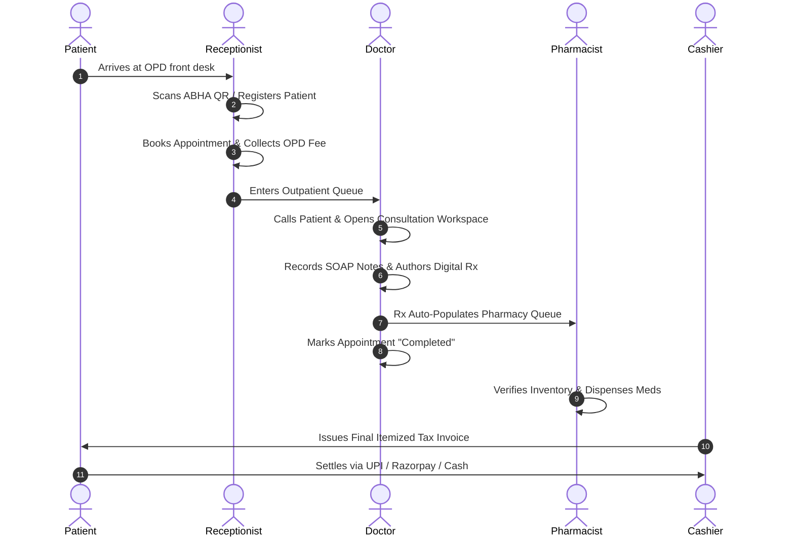

# 🏥 Nivora Care Hospital Management System — Product Requirements Document (PRD)

> **Document Version**: 2.0.0  
> **Status**: Verified Active System & Roadmap  
> **Product Category**: Enterprise Hospital Operating System (HMS / EHR / LIS / RIS / PACS)  
> **Target Audience**: Hospital Administrators, Healthcare Providers, Clinical Staff, Patients, Engineering & AI Agents  

---

## 1. Executive Summary & Product Vision

**Nivora Care Hospital Management System (HMS)** is a mission-critical, unified full-stack healthcare operating system engineered to eliminate departmental data silos across modern healthcare institutions. 

By unifying **8 distinct operational departments**—Executive Administration, Clinical Consultations, Inpatient Nursing, Front Desk Logistics, Pharmacy Operations, Diagnostic Services (Pathology & Radiology), Emergency Care, and Patient Self-Service—Nivora Care delivers real-time clinical workflows, automated financial ledgering, and rigorous compliance auditing from the instant a patient registers.

### 1.1 Core Value Proposition
- **Zero Information Asymmetry**: Clinical orders (prescriptions, diagnostic labs, radiology scans) instantly synchronize to respective department workbenches (Nursing, Pharmacy, Pathology, Radiology) and the Patient Portal.
- **Unified Financial Ledgering**: OPD consultation charges, ward bed tariffs, pharmacy medications, and diagnostic investigations auto-aggregate into tamper-resistant patient invoices with multi-channel payment settlement.
- **National Health Ecosystem Alignment**: Integrated Ayushman Bharat Digital Mission (ABDM) support featuring ABHA (Ayushman Bharat Health Account) 14-digit IDs, QR verification, and digital clinical card issuance.
- **Role-Based Isolation (RBAC)**: Strict server-enforced role boundary guards and IDOR (Insecure Direct Object Reference) prevention.

---

## 2. Target Users & User Personas

| Role | Persona Name | Primary Objectives & Operational Focus |
|---|---|---|
| **Super Admin / Executive** | *Operations & Governance Director* | High-level hospital analytics, occupancy rates, financial ledger reconciliation, department staffing, biomedical equipment uptime, compliance audit logging. |
| **Doctor / Specialist** | *Attending Physician* | Outpatient consultation queue, SOAP clinical documentation, digital prescription authoring with dosage calculation, diagnostic ordering, critical alert triage. |
| **Nurse** | *Inpatient Clinical Staff* | Vital signs tracking, electronic Medication Administration Record (eMAR), fluid Intake/Output monitoring, doctor order execution, shift handovers. |
| **Receptionist / Cashier** | *Front Desk Logistics Officer* | Patient demographic registration, ABHA QR scanning, appointment scheduling, bed admission & discharge coordination, invoice fee collection. |
| **Pharmacist** | *Dispensation & Supply Lead* | Prescription fulfillment queue, batch & expiry quarantine, automated low-stock reorder triggers, supplier purchase orders, returns. |
| **Diagnostic Specialist** | *Pathologist / Radiologist / Tech* | Barcode sample check-in, specimen processing, lab auto-verification rules, DICOM-grade radiology review, multi-layout film generation. |
| **Emergency Officer** | *Emergency Triage Staff* | Rapid emergency patient onboarding, color-coded trauma triage (Red/Yellow/Green), ER resuscitation beds, immediate doctor assignment. |
| **Patient** | *Outpatient / Admitted Patient* | Self-service appointment booking, digital prescriptions, lab test reports, itemized invoice payment via UPI/Razorpay, health history timeline. |

---

## 3. Implemented Features & Verified Modules

### 3.1 Authentication & Security Architecture
- **Multi-Tenant Staff Gateway**: Single secure entry point supporting JWT bearer authentication (`/api/auth/login`).
- **Patient Self-Service Auth**: Dedicated patient authentication supporting password registration and secure phone OTP verification (`/api/patient-auth/*`).
- **Granular RBAC**: Strict Express route protection enforcing access across 18 distinct roles (`admin`, `super_admin`, `doctor`, `nurse`, `receptionist`, `pharmacist`, `lab_technician`, `radiologist`, `pathologist`, `emergency`, `patient`, etc.).
- **Rate Limiting**: Tiered endpoint rate limiting to prevent brute-force attacks on OTP endpoints (5 req/min) and general APIs (100 req/min).

### 3.2 Clinical Outpatient & Doctor Workspace
- **Dynamic Consultation Workspace**: Integrated consultation view linking patient demographics, past medical history, and clinical documentation.
- **Digital Prescription Authoring**: Prescription creation with structured medication dosages, frequencies (OD, BD, TDS), duration, and digital doctor signature stamp.
- **Automated Prescription Delivery**: Direct SMTP email delivery of official hospital digital prescriptions with printable layouts.
- **Doctor Schedule & Leave Management**: Shift slot configuration, availability toggle, and leave tracking.

### 3.3 Inpatient Ward & Bed Allocation Manager
- **Visual Ward Matrix**: Real-time inpatient bed occupancy tracking across 6 standard wards (ICU, CCU, Emergency, General, Pediatric, Private Deluxe).
- **Admission & Bed Allocation**: Patient bed assignment with attending physician linking, admission reason, and expected discharge date.
- **Patient Bed Transfers**: Automated transfer workflow moving patient between wards, updating occupancy status, and resetting the source bed to "cleaning".
- **Discharge Coordination & Bed Tariff Billing**: Auto-calculates total stay duration (minimum 1 day) and automatically generates itemized bed charges on patient bills.

### 3.4 Nursing Station & Inpatient Care
- **Vital Signs Monitoring**: Continuous tracking of Blood Pressure, Heart Rate, SpO2, Temperature, Respiratory Rate, and Blood Glucose.
- **eMAR (Electronic Medication Administration)**: Nursing verification and administration tracking (Mark dose as `given`, `held`, or `refused` with timestamp and nurse signature).
- **Intake & Output Balance**: Fluid balance ledger tracking IV infusions, oral liquids, urine output, and surgical drains.
- **Doctor Orders Execution**: Real-time sync of orders placed by physicians with nursing check-off verification.
- **Shift Handover Reports**: SBAR structured nursing shift handover notes.

### 3.5 Reception, Front Desk & Patient Queue
- **Master Patient Index**: Full patient demographic records with ABHA ID tracking and search by phone, name, or health ID.
- **ABHA QR Identification**: Client-side camera QR barcode scanner (`html5-qrcode`) and downloadable thermal card generation (`qrcode`).
- **Appointment Scheduling**: Real-time slot allocation preventing double-booking of physician consultation calendars.
- **Front Desk Work Queue**: Walk-in queue triage and waiting room status updates.

### 3.6 Pharmacy & Inventory Management
- **Rx Dispensing Queue**: Instant propagation of doctor prescriptions to the pharmacy fulfillment workbench.
- **Batch & Expiry Control**: Multi-batch inventory tracking with expiry dates, quarantine flags, and unit costs.
- **Inventory Alerts**: Real-time low-stock alerts and automated purchase order generation for hospital suppliers.
- **Pharmacy Returns & Restocking**: Track damaged, returned, or expired medicines.

### 3.7 Diagnostic Services (Pathology & Radiology)
- **Pathology Sample Phlebotomy**: Barcode sample collection, specimen labeling, and status tracking (`ordered` -> `collected` -> `analyzing` -> `completed`).
- **Technician & Specialist Workbenches**: Result entry for hematology, biochemistry, microbiology, and pathology panels.
- **Radiology Viewer & Film Sheet Generator**: Radiology study tracking (X-Ray, CT Scan, MRI, Ultrasound) with thermal film sheet preview (1-Up, 4-Up, 9-Up multi-frame layout).
- **Auto-Verification Engine**: Automated flags for normal range checks and critical result escalation.

### 3.8 Emergency Department (ED / ER)
- **Trauma Triage Matrix**: Rapid classification using Red (Resuscitation/Immediate), Yellow (Urgent), Green (Non-Urgent).
- **Emergency Encounter Tracking**: Triage vitals, presenting symptoms, attending doctor assignment, and rapid admission to emergency beds.

### 3.9 Financial Ledger & Billing Gateway
- **Itemized Patient Billing**: Auto-aggregates OPD consultation fees, bed stay tariffs, lab test costs, and pharmacy dispensations.
- **Multi-Payment Channel Settlement**: Support for Cash, Credit/Debit Card, Netbanking, Health Insurance Claims, Instant UPI (with automatic mock 12-digit UTR generator), and Razorpay digital gateway.
- **Automated Tax Invoicing**: PDFKit invoice generator and automated SMTP tax invoice delivery.
- **Public SMS Payment Link**: Unauthenticated, secure payment link (`/pay/:billingId`) allowing patients or sponsors to settle hospital bills remotely via SMS link.

---

## 4. User Roles & Permission Matrix

| Role Identifier | Portal Entry | Read Scope | Write / Action Scope |
|---|---|---|---|
| `super_admin` / `admin` | `/admin/*` | Hospital-wide all data | Full system CRUD, configuration, staff accounts, financial ledgers |
| `doctor` | `/dashboard`, `/doctor/*` | Assigned patients, clinic directory, own schedules | Clinical notes, prescriptions, lab orders, referrals |
| `nurse` | `/nurse/*`, `/beds` | Inpatient wards, bed allocations, vitals | Record vitals, eMAR administration, shift notes, fluid logs |
| `receptionist` | `/reception/*`, `/patients` | Appointments, doctors, beds, billing | Register patients, book appointments, collect payments, admit/discharge |
| `pharmacist` | `/pharmacy/*` | Prescriptions, medicine inventory | Dispense medications, adjust stock, manage purchase orders |
| `lab_technician` / `radiologist` | `/diagnostic/*` | Lab orders, radiology imaging | Enter test results, verify reports, upload radiology studies |
| `emergency` | `/emergency/*` | Emergency queue, trauma beds | Emergency triage, immediate patient admission, ER status |
| `patient` | `/patient/*` | Self medical records, bills, prescriptions | Book appointments, settle bills, download reports |

---

## 5. Non-Functional Requirements (NFRs)

### 5.1 Security & Compliance
- **Password Security**: Passwords hashed with `bcryptjs` using salt rounds >= 10.
- **Token Security**: Stateless JWT authentication with configurable expiry and secret rotation support.
- **Input Validation**: Zero-trust server request validation via **Zod** schemas for all client-submitted mutations.
- **Data Protection**: Sensitive credential isolation via `server/config/env.js`; no secret values hardcoded in source control.

### 5.2 Performance & Scalability
- **Client Bundle Delivery**: Vite production bundle splitting with dynamic code splitting (`lazy` & `Suspense`) achieving sub-8s cold builds.
- **Database Query Performance**: Indexed MongoDB collections across `patient`, `doctor`, `appointmentDate`, `status`, and `prescriptionNumber`.
- **API Response Optimization**: Gzip/Brotli HTTP compression via Express `compression` middleware.

### 5.3 Reliability & Offline Resilience
- **Zero-Crash Resilience**: Centralized operational error handling via `asyncHandler` and `AppError` preventing unhandled promise rejections.
- **Client Error Boundaries**: React Error Boundary wrappers preventing white-screen crashes on runtime client exceptions.
- **Offline Demo Fallback**: Seed scripts and mock fallback mechanisms allowing system demonstrations even without live database connections.

---

## 6. End-to-End Clinical Workflows

### 6.1 Standard Outpatient Consultation Workflow


### 6.2 Inpatient Admission & Discharge Lifecycle
```mermaid
sequenceDiagram
    autonumber
    actor Doctor
    actor Nurse
    actor BedManager as Reception / Bed Desk
    actor Billing

    Doctor->>BedManager: Recommends Inpatient Admission (e.g., ICU / General)
    BedManager->>BedManager: Allocates Bed from Visual Ward Matrix (Status: Occupied)
    Nurse->>Nurse: Records Baseline Vitals & Intake/Output
    Nurse->>Nurse: Administers Prescribed Doses via eMAR
    Doctor->>Doctor: Reviews Patient & Authorizes Clinical Discharge
    BedManager->>BedManager: Initiates Discharge; Bed resets to "Cleaning"
    BedManager->>Billing: Stay Duration Multiplied by Daily Rate
    Billing->>Billing: Final Consolidated Bill Generated for Settlement
```

---

## 7. Known Limitations & Roadmap

### 7.1 Existing Technical Debt & Temporary Implementations
- **WebRTC Signaling**: Telemedicine consult rooms use mock/signal room tokens rather than a dedicated TURN/STUN server cluster.
- **SMS Gateway**: Outbound payment link SMS currently falls back to simulation mode unless an external HTTP SMS gateway domain is configured.
- **Third-Party Lab Equipment Interfaces**: Lab auto-verification operates on algorithmic range rules; direct ASTM/HL7 serial device drivers are not yet integrated.

### 7.2 Planned Future Capabilities
1. **FHIR / HL7 v2 Gateway**: Standardized interoperability with external national EHR networks and insurance clearinghouses (EDI 837/835).
2. **AI Screening Integration**: Diagnostic chest X-Ray and CT automated preliminary finding suggestions.
3. **Multi-Branch Tenant Partitioning**: Support for multi-hospital chains with cross-hospital patient transfers and consolidated financial reporting.
