<a id="top"></a>

<div align="center">

**NHMS · ENTERPRISE HOSPITAL OPERATING SYSTEM**

# 🏥 Nivora Care Hospital

### Next-Generation Unified Enterprise Hospital Management System (HMS)

[](https://nodejs.org/)
[](https://expressjs.com/)
[](https://www.mongodb.com/)
[](https://react.dev/)
[](https://vitejs.dev/)
[](https://tailwindcss.com/)
[](#author-license)

<br/>

> A mission-critical, end-to-end full-stack healthcare operating system that connects **7 specialized portals** — Administration, Doctors, Nursing, Reception, Pharmacy, Diagnostic Services (Pathology &amp; Radiology), and Patient Self-Service — into one event-driven, role-isolated platform.

<br/>

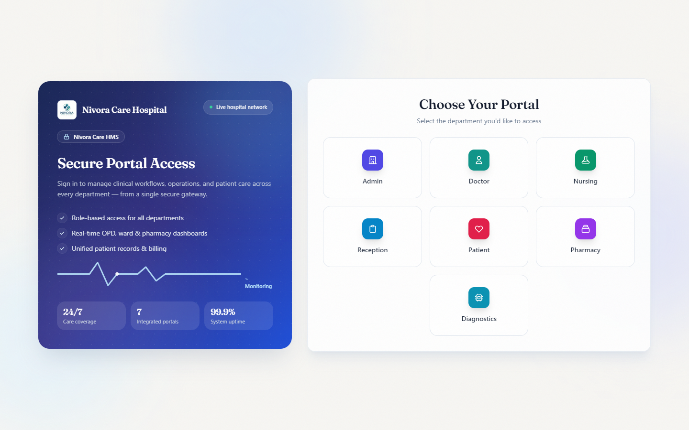

<p><em>Unified Healthcare Gateway — a single responsive entry point providing role-isolated access to every clinical and administrative department.</em></p>

</div>

---

## Table of Contents

| | Section | Description |
|---|---|---|
| 🏥 | [Overview](#overview) | System objectives, the architectural problem solved, and key value drivers |
| ⚡ | [System Highlights](#system-highlights) | At-a-glance capability matrix across all 7 hospital departments |
| 🏢 | [Hospital Portals](#hospital-portals) | In-depth feature, workflow and screen breakdown per portal |
| 🔄 | [Cross-Portal Workflows](#cross-portal-workflows) | Event-driven data synchronization across clinical & financial departments |
| 🔁 | [Real-World Workflows](#real-world-workflows) | Step-by-step lifecycles for Pathology, Radiology CT and Medication MAR |
| 🏗️ | [Architecture](#architecture) | Full-stack architecture — React 19 + Express + MongoDB Atlas |
| 🗄️ | [Database Schema & Indexing](#database-schema) | High-performance compound & partial index configurations |
| 📁 | [Medical File Storage](#medical-file-storage) | Dynamic PDF reports, thermal film generator & static asset CDN |
| 🔒 | [Security & Access Control](#security-access-control) | RBAC middleware, JWT auth, IDOR guards & rejection tests |
| 🖼️ | [Screenshot Gallery](#complete-screenshot-gallery) | Collapsible visual catalog of all 7 portals |
| 🔐 | [Portal Login Pages](#portal-logins) | Dedicated sign-in screens for every staff role plus the patient portal |
| ⚙️ | [Installation & Setup](#installation-setup) | Prerequisites and step-by-step start commands |
| 🔑 | [Environment Variables](#environment-variables) | Complete `.env` guide for client and server |
| 🧪 | [Demo Test Accounts](#demo-test-accounts) | Pre-seeded credentials for instant testing across all roles |
| 🧪 | [Automated System Diagnostics](#verification-diagnostics) | 24-point optimization & security verification suite |
| 📂 | [Project Structure](#project-structure) | Tree map of frontend, backend and documentation |
| 🔮 | [Future Improvements](#future-improvements) | Roadmap — FHIR/HL7, AI screening, telemedicine, IoT |
| 👨‍💻 | [Author & License](#author-license) | Project creator, GitHub profile and MIT license |

---

## <a id="overview"></a>🏥 Overview

Modern clinical operations fail when data remains trapped in departmental silos. **Nivora Care Hospital** solves this fragmentation with a real-time, event-driven architecture — patient admission, clinical diagnosis, nursing care, lab orders, pharmacy dispensing and financial ledgering are tightly synchronized from the moment a patient walks in.

### Core Value Drivers

- **Zero Information Loss** — A doctor's prescription instantaneously populates both the **Pharmacy Dispensing Queue** and the **Patient Prescription Portal**.
- **Integrated Diagnostics &amp; PACS** — Lab test orders flow directly to Phlebotomy and Laboratory workbenches, while Radiology orders render DICOM-grade imaging with film layout engines (**1-Up, 4-Up, 9-Up**).
- **Financial Ledgering** — OPD consultations, nursing bed tariffs, pharmacy medications and diagnostic investigations auto-aggregate into unified patient invoices.
- **Strict Role Isolation** — Server-enforced Role-Based Access Control (RBAC) protects medical record privacy and blocks access across departmental boundaries.

---

## <a id="system-highlights"></a>⚡ System Highlights

| Module | Core Purpose & Operations | Supported Capabilities |
|---|---|---|
| **🧑‍💼 Admin** | Operational Oversight & Governance | Revenue analytics, staff management, department/equipment tracking, audit trail logs, bed capacity metrics. |
| **👨‍⚕️ Doctor** | Clinical Workspace & Consultations | Patient consultation, SOAP note recording, Rx prescription writing, diagnostic ordering, critical result alerts. |
| **👩‍⚕️ Nurse** | Inpatient Monitoring & Nursing Care | Real-time vital sign recording, MAR medication administration, fluid intake/output balance, shift handover notes. |
| **🧾 Receptionist** | Front Desk & Queue Logistics | Patient registration, walk-in tokens, doctor schedule booking, inpatient bed admissions, cashier payment settlement. |
| **💊 Pharmacy** | Inventory & Medication Dispensing | Real-time prescription fulfillment queue, batch/expiry tracking, low-stock reorder triggers, supplier PO management. |
| **🧪 Diagnostics** | Pathology Labs & Radiology DICOM | Phlebotomy sample barcode tracking, laboratory result entry, PACS radiology DICOM viewer, film sheet generator. |
| **👤 Patient** | Patient Self-Service Portal | Online appointment scheduling, digital prescription downloads, lab result portal sync, invoice payments. |

---

## <a id="hospital-portals"></a>🏢 Hospital Portals

### <a id="admin-portal"></a>🧑‍💼 Admin Portal

**Overview** — The **Admin Portal** is the command center for hospital executive leadership, delivering real-time financial tracking, audit logging, facility management and human-resource oversight.

| Feature | Technical Description | Operational Impact |
|---|---|---|
| **Executive Dashboard & KPIs** | Live MongoDB aggregations for occupancy, daily revenue, and active clinical cases. | Instant visibility into hospital throughput and revenue streams. |
| **Staff & Doctor Directory** | Full CRUD controls for personnel, credentials and departmental mapping. | Controls employee directory and system authentication access. |
| **Department & Equipment Tracker** | Equipment maintenance schedules, status flags and asset utilization logs. | Prevents critical biomedical equipment downtime. |
| **Bed & Ward Occupancy** | Real-time matrix of General, ICU, Ventilator and Private ward availability. | Maximizes bed turnover efficiency and emergency triage. |
| **System Audit Trail** | Immutable log of every login, record modification and payment transaction. | Guarantees compliance and NABH security auditing. |

**Screenshots**

<div align="center">

**Admin Executive Dashboard & Financial Analytics**
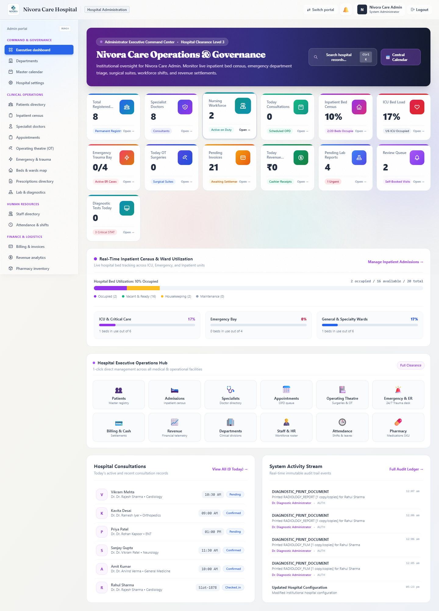
> *Macro operational analytics, departmental breakdown, bed occupancy statistics and quick navigation actions.*

<br/>

**Hospital Staff & Personnel Directory**
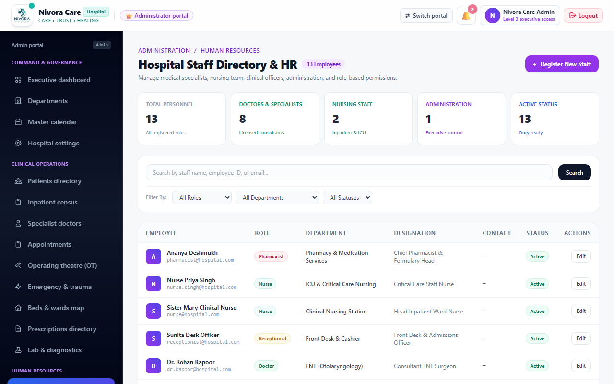
> *Clinical staff onboarding, role permissions and active employment status management.*

</div>

<p align="right"><a href="#top">⬆ Back to Top</a></p>

---

### <a id="doctor-portal"></a>👨‍⚕️ Doctor Portal

**Overview** — Built for high-speed clinical environments, the **Doctor Portal** streamlines consultation workspaces, electronic health record (EHR) review, instant prescription writing and diagnostic investigation requests.

| Feature | Technical Description | Operational Impact |
|---|---|---|
| **Appointments Queue** | Filterable queue showing pending, checked-in and completed consultations for the day. | Optimizes OPD throughput and reduces patient wait times. |
| **Consultation Workspace** | Integrated interface with patient medical history, past vitals and current complaints. | Centralizes patient EHR data during face-to-face consultations. |
| **Prescription Builder** | Structured drug form with dosage, frequency, duration and food instructions. | Eliminates handwritten prescription ambiguity and feeds the Pharmacy queue. |
| **Diagnostic Test Orders** | Dual-type orders for Pathology (Blood/Urine) and Radiology (X-Ray/CT/MRI). | Initiates cross-portal diagnostic processing without paperwork. |
| **Critical Result Alerts** | High-priority banner alerts for abnormal panic lab values. | Accelerates urgent clinical interventions for critical patients. |

**Screenshots**

<div align="center">

**Doctor Clinical Dashboard & Today's Schedule**
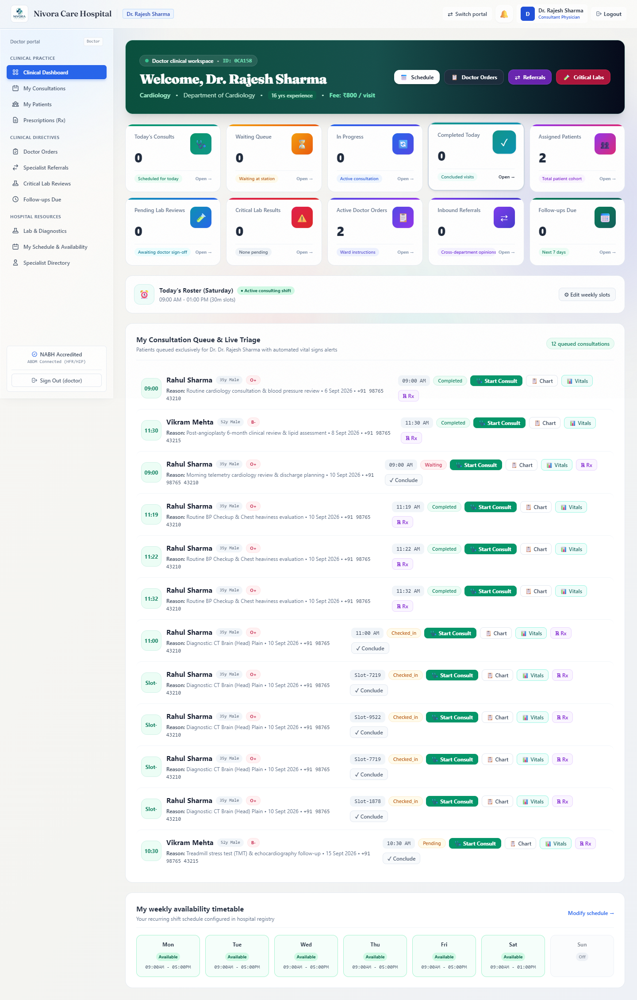
> *Daily appointment queues, quick patient lookups and recent clinical activities.*

<br/>

**Consultation & Electronic Health Record Workspace**

> *Inspect vitals history, record diagnostic findings and generate prescriptions in one screen.*

</div>

<p align="right"><a href="#top">⬆ Back to Top</a></p>

---

### <a id="nurse-portal"></a>👩‍⚕️ Nurse Portal

**Overview** — The **Nurse Portal** equips bedside teams with real-time patient monitoring, vital signs entry, medication administration records (MAR), intake/output tracking and structured shift handovers.

| Feature | Technical Description | Operational Impact |
|---|---|---|
| **Nursing Station Dashboard** | Overview of admitted ward patients, pending vitals and active nursing alerts. | Keeps shift nurses synchronized on inpatient care tasks. |
| **Vital Signs Recorder** | Input for BP, Heart Rate, SpO2, Temperature, Respiratory Rate and Pain Scale. | Tracks trend graphs and alerts doctors to clinical deterioration. |
| **Medication Administration (MAR)** | Timed medication schedule auto-populated from doctor prescriptions. | Prevents missed or duplicate drug doses for ward inpatients. |
| **Intake & Output Balance** | Fluid balance calculator logging oral/IV intake vs. urine/drainage output. | Essential for nephrology, ICU and post-surgical recovery. |
| **Shift Handover Log** | Structured notes transferring care responsibility between shifts. | Ensures continuous, error-free patient handovers. |

**Screenshots**

<div align="center">

**Nursing Station Dashboard & Inpatient Care Overview**
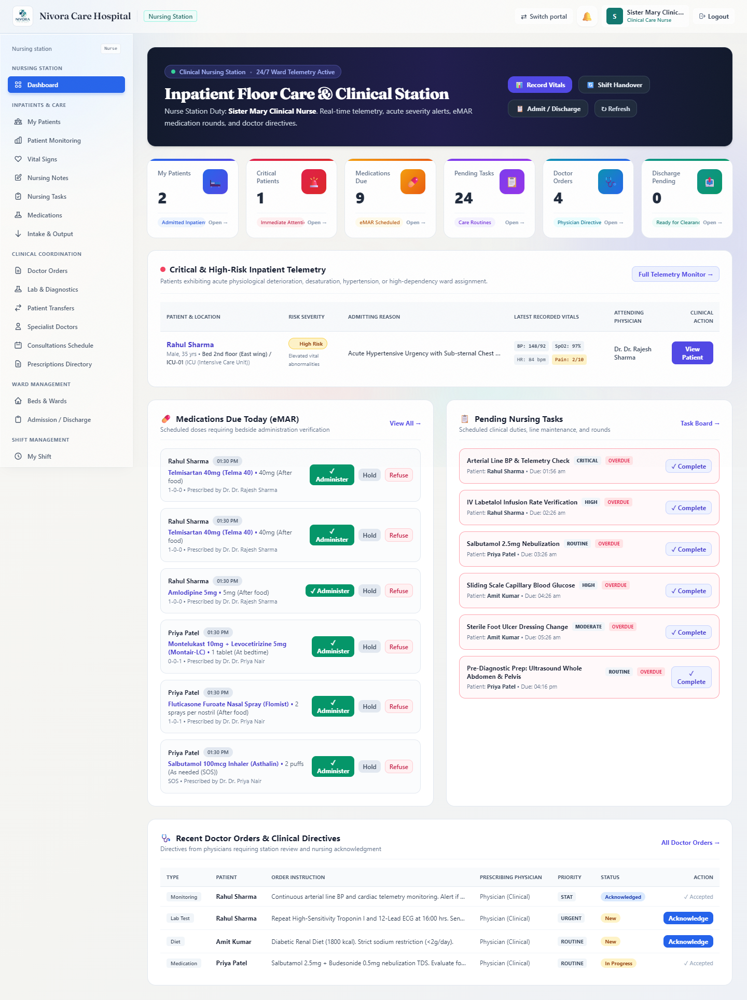
> *Assigned ward beds, pending nursing tasks and current patient vital statuses.*

<br/>

**Bedside Vital Signs Recorder**

> *Vital sign recording, body metric calculation and abnormal reading detection.*

</div>

<p align="right"><a href="#top">⬆ Back to Top</a></p>

---

### <a id="receptionist-portal"></a>🧾 Receptionist Portal

**Overview** — The **Receptionist Portal** manages patient entry, OPD registration, waiting-room token queues, doctor schedule booking, inpatient bed allocation and multi-channel billing settlement.

| Feature | Technical Description | Operational Impact |
|---|---|---|
| **Patient Registration** | Comprehensive demographic capture with unique MRN generation. | Establishes the master patient index across all departments. |
| **OPD Token & Queue Manager** | Real-time token generator assigning patients to doctor waiting rooms. | Reduces waiting-hall congestion through structured token numbering. |
| **Ward & Bed Allocations** | Matrix for admitting patients, room transfers and discharges. | Manages physical bed assets and room tariff calculations. |
| **Cashier & Billing Desk** | Invoice settlement via Cash, UPI QR, Card, Insurance TPA and NetBanking. | Ensures immediate collection and transparent patient receipts. |
| **SMS Payment Link Dispenser** | SMS gateway dispatch of remote payment links to patient phones. | Enables contactless payments for families or remote settlement. |

**Screenshots**

<div align="center">

**Front Desk Reception Dashboard & Operations**
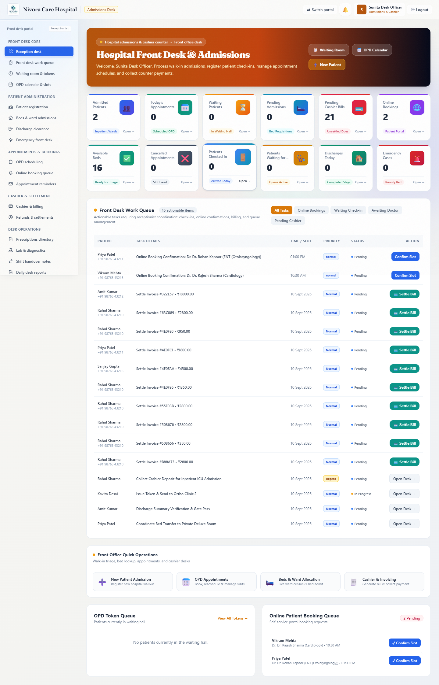
> *Daily registrations, OPD token statuses and cashier desk metrics.*

<br/>

**Waiting Room OPD Token Management**

> *Active consultations, waiting patients and doctor availability in real time.*

</div>

<p align="right"><a href="#top">⬆ Back to Top</a></p>

---

### <a id="pharmacy-portal"></a>💊 Pharmacy Portal

**Overview** — The **Pharmacy Portal** controls medication inventory, batch tracking, prescription fulfillment queues, supplier purchase orders and automated stock reordering.

| Feature | Technical Description | Operational Impact |
|---|---|---|
| **Prescription Fulfillment Queue** | Real-time queue auto-populated when a doctor signs a digital prescription. | Enables instant dispensing without paper prescriptions. |
| **Batch & Expiry Management** | FEFO (First-Expired, First-Out) tracking by batch number and expiry date. | Prevents expiry-related stock loss and protects patient safety. |
| **Inventory Stock Control** | Itemized drug database with stock levels, reorder thresholds and category tags. | Automates low-stock alerts and purchase requests. |
| **Supplier & Purchase Orders** | PO creation, stock receipt logging and vendor management. | Streamlines procurement and vendor billing. |
| **Direct Dispense Billing** | Automatic drug quantity calculation synced with the Cashier. | Feeds pharmacy sales directly into the master financial ledger. |

**Screenshots**

<div align="center">

**Pharmacy Inventory & Fulfillment Dashboard**
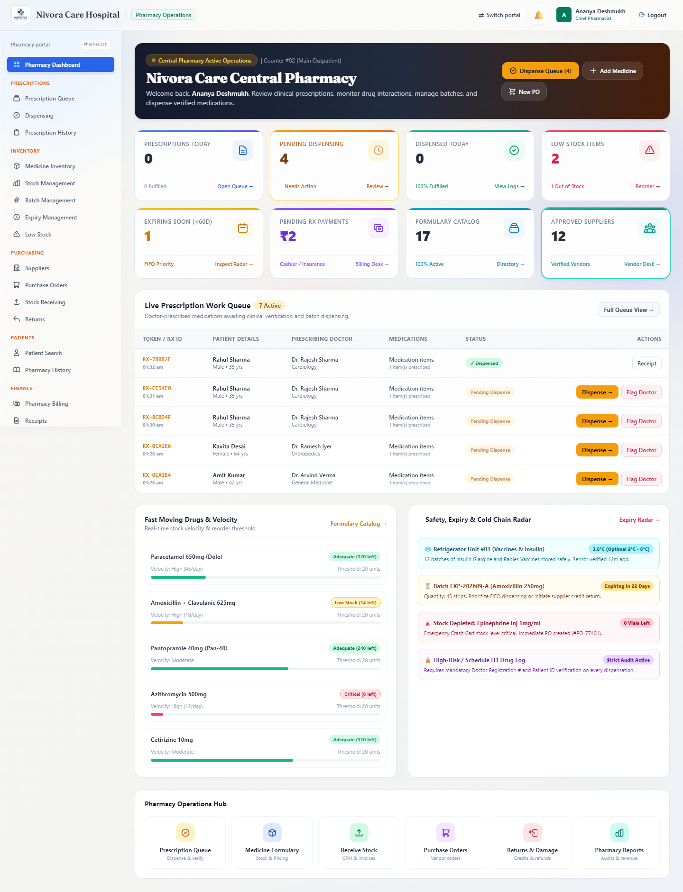
> *Pending prescription count, low-stock warnings and daily sales metrics.*

<br/>

**Prescription Dispensing Queue**

> *Fulfilling incoming prescriptions, allocating drug batches and completing orders.*

</div>

<p align="right"><a href="#top">⬆ Back to Top</a></p>

---

### <a id="diagnostic-services-portal"></a>🧪 Diagnostic Services Portal

**Overview** — A dual-subsystem platform combining **Pathology / Laboratory Medicine** with **Radiology / Medical Imaging (PACS)**, governing the complete diagnostic life cycle from doctor order to final report distribution.

```
🧪 DIAGNOSTIC SERVICES PORTAL
            │
   ┌────────┴────────┐
   ▼                 ▼
🧪 PATHOLOGY                     📷 RADIOLOGY / IMAGING
• Phlebotomy Sample Collection   • Worklist Queue (X-Ray/CT/MRI/USG)
• Barcode Tracking & Rack Maps   • PACS DICOM Imaging Viewer
• Lab Workbench (Hemo/Biochem)   • Findings & Impression Entry
• Pathologist Review & Approval  • Laser Film Sheet Generator (1/4/9-Up)
• PDF Pathology Reports          • Formal Radiology Report Printing
```

| Diagnostic Domain | Sub-Module | Key Operational Capabilities |
|---|---|---|
| **Phlebotomy & Sample Lab** | **Sample Collection** | Barcode generation, container tracking (EDTA, Serum, Fluoride), timestamping and rack placement. |
| | **Lab Workbench** | Numerical result entry for Hematology, Biochemistry and Microbiology with automatic high/low panic flags. |
| | **Pathologist Review** | Senior-pathologist workflow that verifies abnormal readings before report authorization. |
| **Radiology & PACS Imaging** | **Imaging Worklist** | Modality filtering across X-Ray, CT, MRI, Ultrasound and Mammography. |
| | **DICOM Visualizer** | Web-based medical imaging viewer with zoom, pan, contrast and measurement overlays. |
| | **Radiology Reporting** | Structured editor for Clinical Indications, Imaging Findings and Diagnostic Impressions. |
| | **Film Sheet Generator** | Print engine rendering DICOM series into **1-Up, 4-Up, 9-Up** laser film layouts. |
| **Administrative & Safety** | **Critical Panic Alerts** | Instant dispatch of critical lab/radiology results to attending doctors. |
| | **Diagnostic Inventory** | Reagent and film stock tracking with automated per-test consumption. |
| | **Print Center & Audit** | Centralized logging of every printout, reprint request and PDF download. |

**Screenshots**

<div align="center">

**Diagnostic Services Master Gateway**
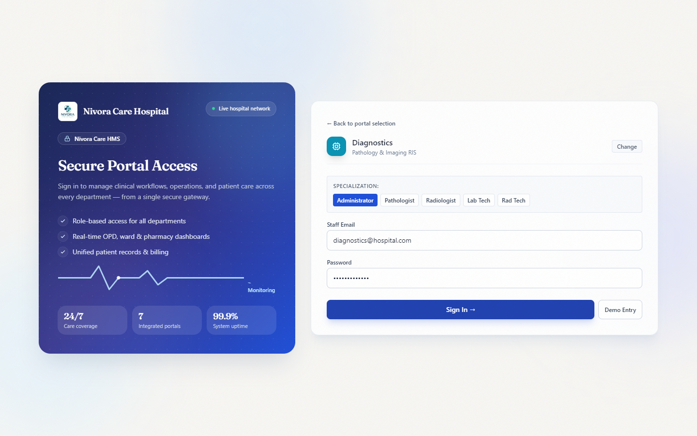
> *Entry point for diagnostic staff selecting specialized sub-roles (Phlebotomist, Lab Tech, Radiologist, Pathologist).*

<br/>

**PACS Radiology Imaging & DICOM Viewer**
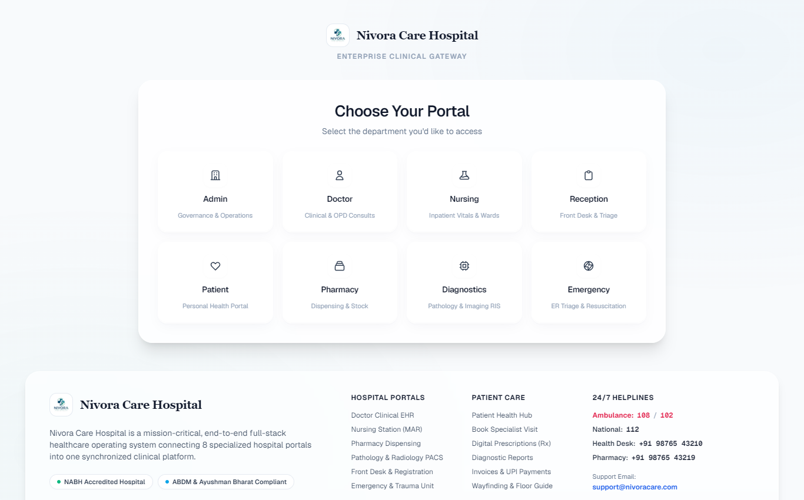
> *Chest X-ray viewing with zoom controls, measurement overlays and a diagnostic report panel.*

<br/>

**Laser Radiology Film Sheet Generator (4-Up Layout)**
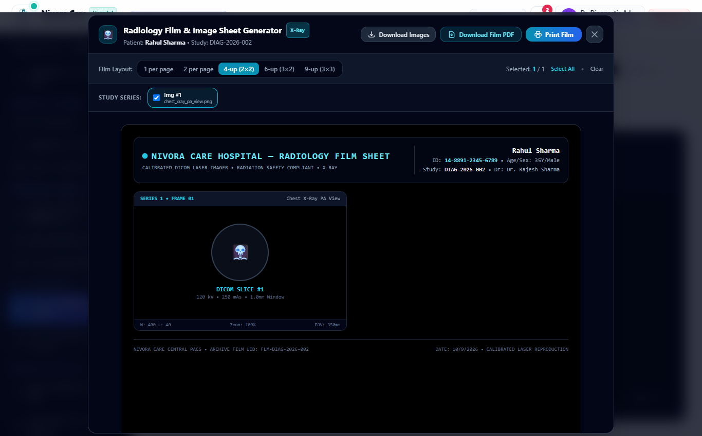
> *4-Up CT slice layout rendered for thermal laser film printing.*

</div>

<p align="right"><a href="#top">⬆ Back to Top</a></p>

---

### <a id="patient-portal"></a>👤 Patient Portal

**Overview** — The **Patient Portal** puts patients in control of their healthcare journey with self-service appointment booking, prescription access, diagnostic report downloads and invoice payments.

| Feature | Description |
|---|---|
| **Patient Dashboard** | Personal health summary: upcoming appointments, active prescriptions and recent lab tests. |
| **Book Appointment** | Self-service booking with doctor specialization selection and real-time slot availability. |
| **Digital Prescriptions** | All active and past prescriptions with dosage details and downloadable PDFs. |
| **Diagnostic Reports** | Instant access to finalized Pathology reports and Radiology studies once approved. |
| **Invoice & Payments** | Outstanding-bill overview with direct UPI, Card or NetBanking payment. |

**Screenshots**

<div align="center">

**Patient Self-Service Dashboard**
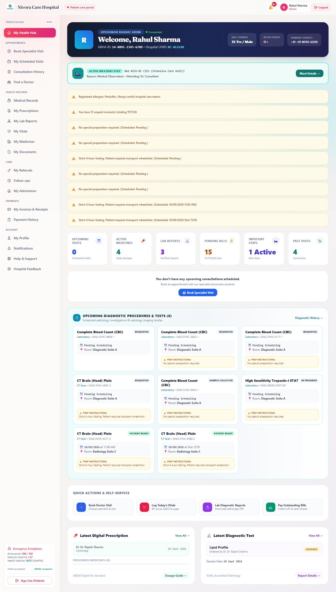
> *Health timeline, upcoming visits, active medications and quick action buttons.*

<br/>

**Patient Self-Service Appointment Booking**
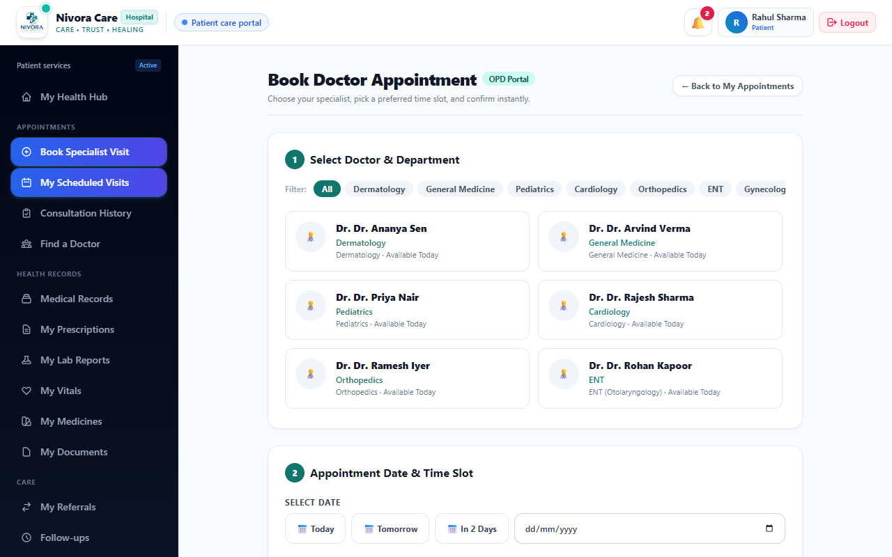
> *Select departments, doctors and available time slots.*

</div>

<p align="right"><a href="#top">⬆ Back to Top</a></p>

---

## <a id="cross-portal-workflows"></a>🔄 Cross-Portal Workflows & Integration

Data recorded in one portal instantly propagates to every relevant department — no manual re-entry.

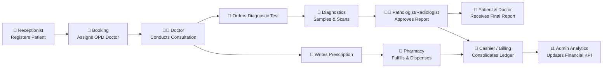

---

## <a id="real-world-workflows"></a>🔁 Real-World Workflow Examples

### Workflow 1 — Pathology Investigation Cycle
```
1. 👨‍⚕️ Doctor orders "Complete Blood Count (CBC)" during consultation.
   │
   ▼
2. 🧾 System auto-generates Diagnostic Order & creates a pending billing entry.
   │
   ▼
3. 🧪 Phlebotomist views the order in Sample Collection -> Collects blood -> Scans EDTA Barcode.
   │
   ▼
4. 🧪 Lab Technician runs the sample -> Enters Hemoglobin, WBC, Platelet values in Workbench.
   │
   ▼
5. 👨‍⚕️ Senior Pathologist reviews abnormal flags -> Clicks "Approve & Sign Report".
   │
   ▼
6. 📲 Finalized PDF syncs to the Patient Portal + Attending Doctor receives an instant notification.
```

### Workflow 2 — Radiology CT Scan & Laser Film Printing
```
1. 👨‍⚕️ Doctor orders "CT Thorax Contrast" for a trauma patient.
   │
   ▼
2. 🧪 Radiology Worklist receives the order -> Radiographer performs the scan -> Uploads DICOM series.
   │
   ▼
3. 👨‍⚕️ Radiologist opens the PACS Viewer -> Inspects axial slices -> Writes Findings & Impression.
   │
   ▼
4. 🧪 Film Print Center generates a 4-Up Laser Film Sheet -> Sends to the thermal DICOM printer.
   │
   ▼
5. 📄 Formal Radiology Report & Laser Film dispatched to the ward; PDF attached to the patient EHR.
```

### Workflow 3 — Inpatient Medication & MAR Cycle
```
1. 👨‍⚕️ Doctor prescribes IV Antibiotics for an admitted ward patient.
   │
   ▼
2. 💊 Pharmacy receives the order -> Verifies batch expiry -> Dispenses drug to the ward station.
   │
   ▼
3. 👩‍⚕️ Nurse receives the medication -> Opens the MAR Schedule -> Administers the dose -> Logs timestamp.
   │
   ▼
4. 🧾 Billing Ledger auto-adds the drug cost to the patient's daily IPD invoice.
```

---

## <a id="architecture"></a>🏗️ Architecture

A modern decoupled architecture separating presentation, business logic, persistence and static object storage.

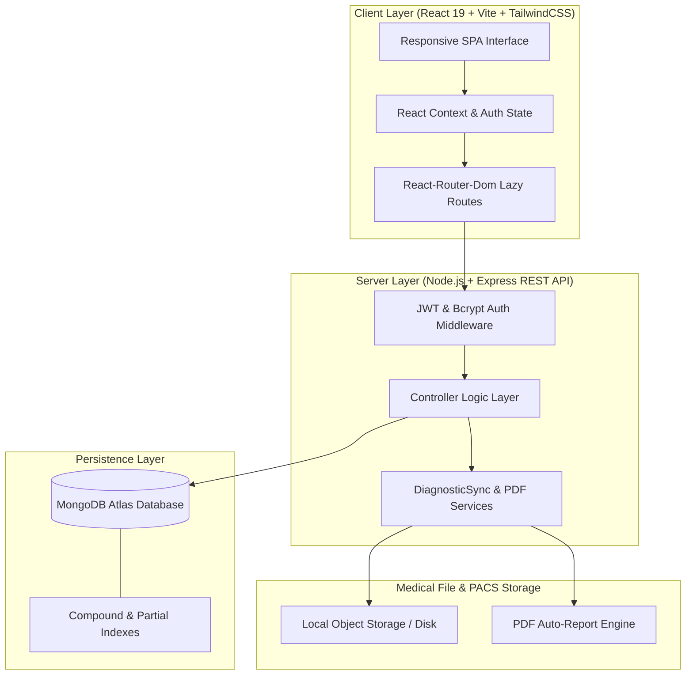

---

## <a id="database-schema"></a>🗄️ Database Schema & Indexing

The backend uses **Mongoose** over **MongoDB Atlas**. All core collections use compound and partial indexes to eliminate collection scans (`COLLSCAN`) under heavy concurrent load.

```javascript
// Appointment — compound double-booking prevention index
AppointmentSchema.index(
  { doctorId: 1, appointmentDate: 1, timeSlot: 1 },
  { unique: true, partialFilterExpression: { status: { $ne: "cancelled" } } }
);

// Billing — patient invoice lookup index
BillingSchema.index({ patientId: 1, createdAt: -1 });

// Notification — unread-alert index
NotificationSchema.index({ userId: 1, isRead: 1 });

// Patient — fast MRN & name search indexes
PatientSchema.index({ mrn: 1 }, { unique: true });
PatientSchema.index({ lastName: 1, firstName: 1 });
```

---

## <a id="medical-file-storage"></a>📁 Medical File & Laser Film Storage

Diagnostic scans, PDF reports and radiology film prints are managed by a dedicated storage service (`server/services/storageService.js` and `pdfReportService.js`).

- **File Path Routing** — Scans are stored under `server/storage/medical_files/` and exposed via secure static endpoints (`/medical_scans/`).
- **PDF Report Generation** — Clinical reports are compiled into official hospital PDFs with header, QR verification code, pathologist signature and reference ranges.
- **DICOM & Film Sheet Engine** — Multi-slice grid export (**1-Up, 4-Up, 9-Up**) formatted for laser film printing.

---

## <a id="security-access-control"></a>🔒 Security & Access Control

Multi-layered security enforced across both backend APIs and frontend UI routes:

1. **JWT Authentication** — 7-day signed tokens carrying user identity and explicit role payloads.
2. **Bcrypt Password Hashing** — Passwords salted and hashed with 10 salt rounds before persistence.
3. **IDOR Guarding** — API endpoints (e.g., `diagnosticController.js`) enforce ownership checks so patients can only access their own records.
4. **Server-Side RBAC Middleware**:
   ```javascript
   // Backend role guard example
   router.post('/doctors', protect, restrictTo('admin'), createDoctor);
   ```
5. **Security Isolation Verification**:

<div align="center">

**Role-Based Access Control Barrier (Unauthorized Access Blocked)**
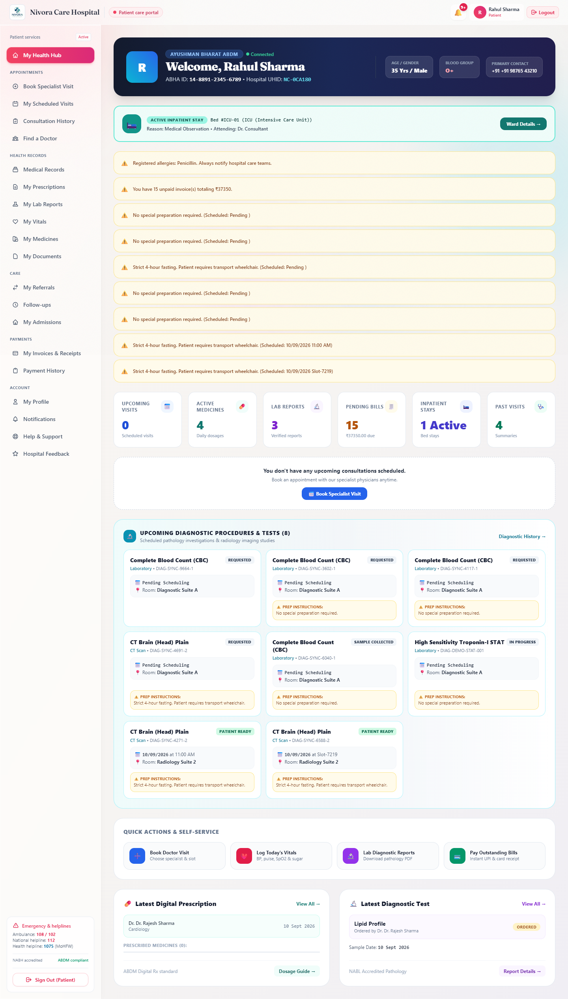
> *Server-side rejection (403 Forbidden) when a lower-privileged role attempts admin access.*

</div>

---

## <a id="complete-screenshot-gallery"></a>🖼️ Complete Screenshot Gallery

<details>
<summary><b>🔍 Click to Expand Complete Screenshot Gallery (All 7 Portals)</b></summary>

<br/>

### 1. Unified Gateway & Authentication
| Gateway Desktop (1280px) | Sub-Role Selector Gateway |
|---|---|
|  |  |

### 2. Admin Portal Screenshots
| Dashboard Overview | Patient Directory | Ward Bed Occupancy |
|---|---|---|
|  | 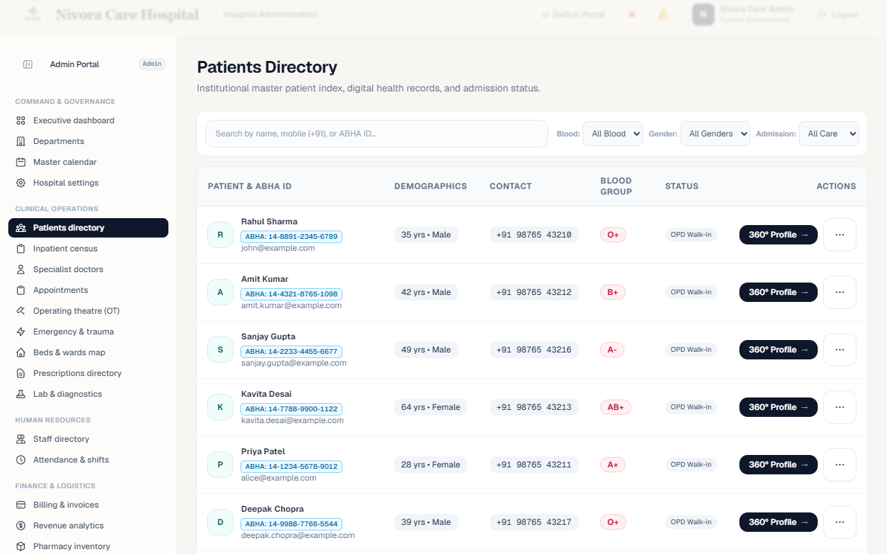 | 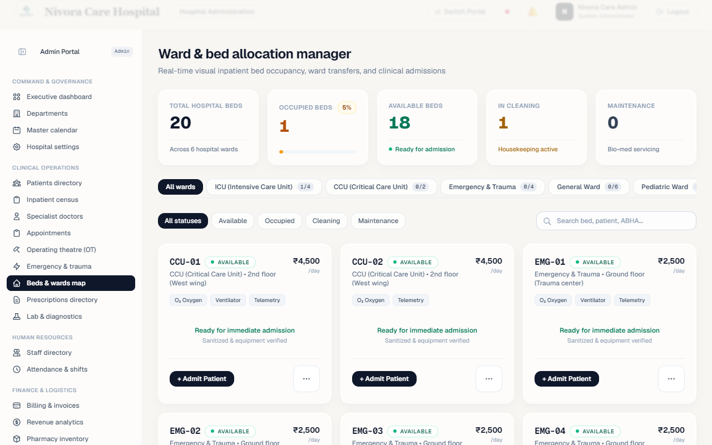 |

### 3. Doctor Portal Screenshots
| Doctor Dashboard | Consultation Workspace | Lab Order Request |
|---|---|---|
|  |  |  |

### 4. Nurse Portal Screenshots
| Nursing Station | Bedside Vitals Recorder | Nursing Task List |
|---|---|---|
|  |  |  |

### 5. Receptionist Portal Screenshots
| Reception Dashboard | Waiting Room Tokens | Cashier & Billing Desk |
|---|---|---|
|  |  |  |

### 6. Pharmacy Portal Screenshots
| Pharmacy Overview | Dispensing Queue | Medicine Inventory |
|---|---|---|
|  |  |  |

### 7. Diagnostic Services Screenshots
| PACS DICOM Viewer | 4-Up Radiology Film Sheet | Formal Report Generator |
|---|---|---|
|  |  |  |

### 8. Patient Portal Screenshots
| Patient Dashboard | My Appointments | My Billing Invoices |
|---|---|---|
|  | 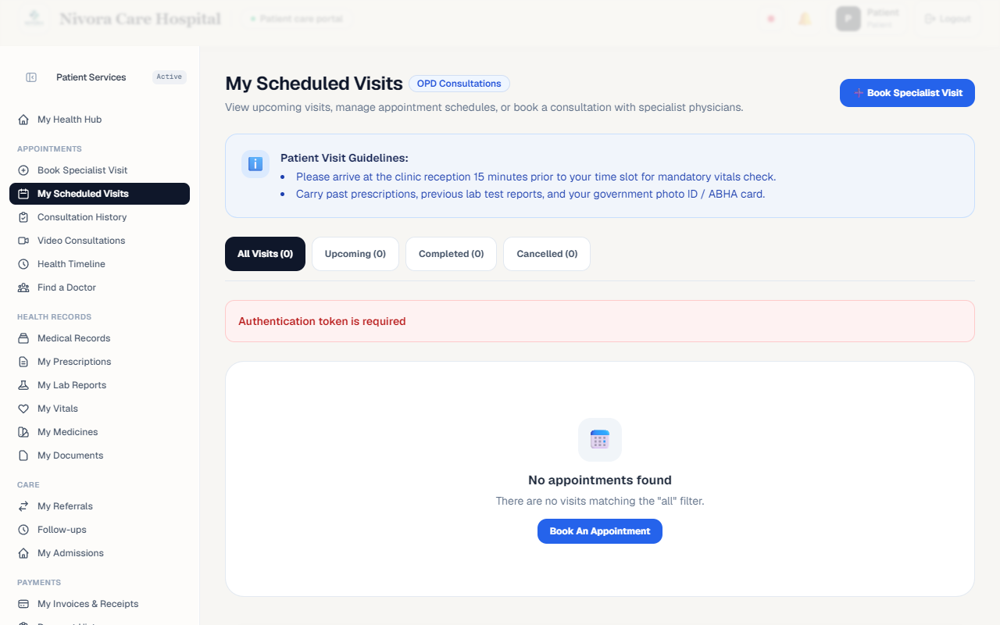 | 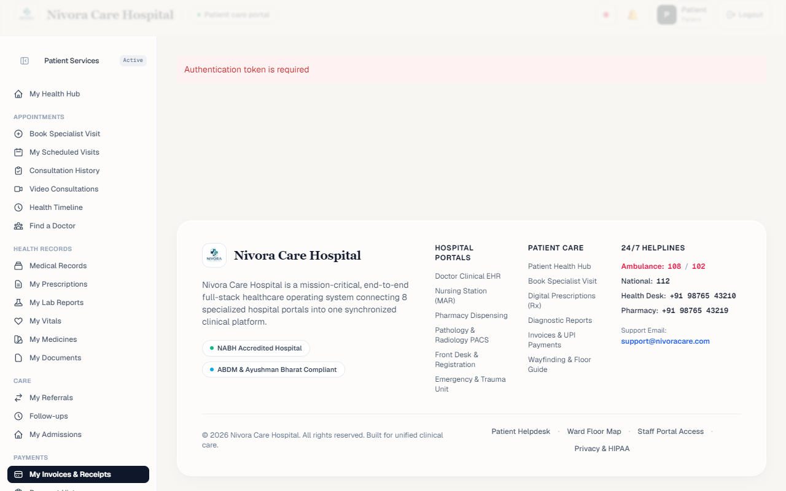 |

</details>

---

## <a id="portal-logins"></a>🔐 Portal Login Pages

Every staff role signs in through the unified gateway; each view pre-configures the matching credentials and, for Diagnostics, the specialization pills. Patients use their own dedicated rose-themed sign-in.

| Admin | Doctor | Nursing |
|---|---|---|
|  |  |  |

| Reception | Pharmacy | Diagnostics |
|---|---|---|
| 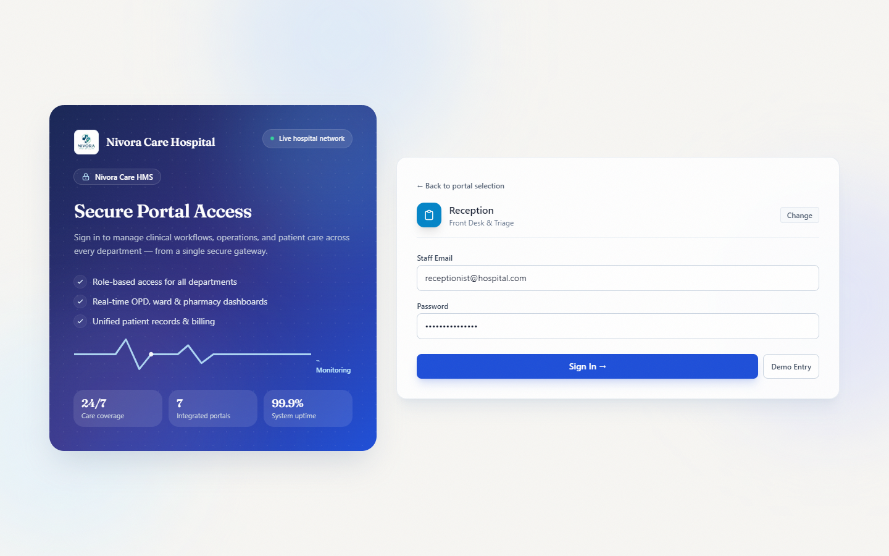 |  | 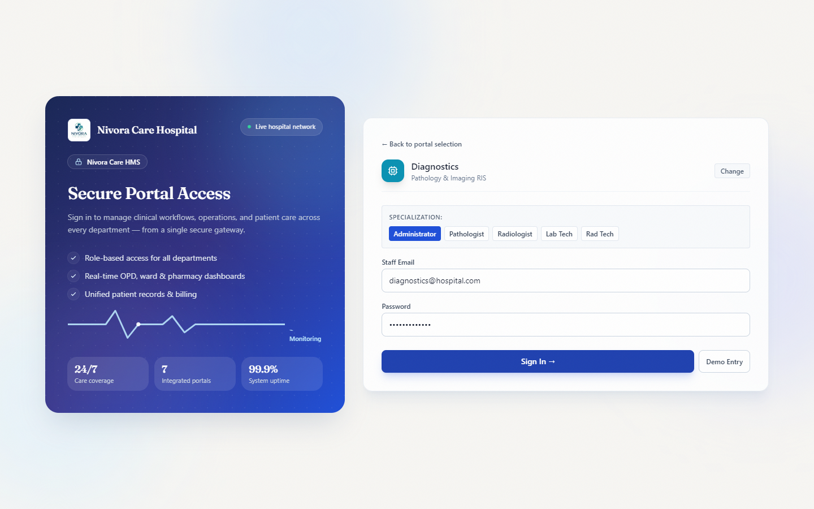 |

| Patient |
|---|
| 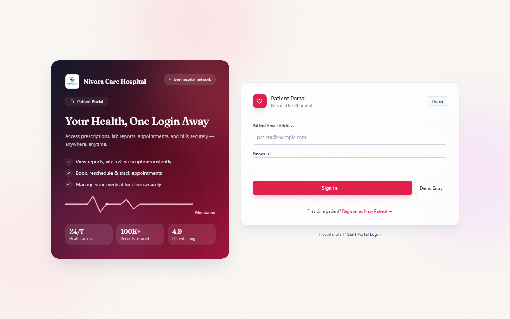 |

---

## <a id="installation-setup"></a>⚙️ Installation & Setup

### Prerequisites

- **Node.js** — v18.0.0 or higher
- **MongoDB** — local instance at `mongodb://127.0.0.1:27017`, or a MongoDB Atlas cluster URI
- **npm** — v8.0.0 or higher

### Step 1 — Clone the Repository
```bash
git clone https://github.com/priyammandal11073-source/Hospital-Management-System.git
cd Hospital-Management-System
```

### Step 2 — Install Dependencies
```bash
# Root + client + server dependencies
npm run install:all
```

<details>
<summary><b>Manual install (equivalent steps)</b></summary>

```bash
npm install
cd server && npm install
cd ../client && npm install
cd ..
```

</details>

### Step 3 — Configure Environment Variables
Create `.env` files in both `server/` and `client/` using the [Environment Variables](#environment-variables) guide.

### Step 4 — Seed the Database (Optional but Recommended)
Populates test accounts, doctors, patients, wards, inventory and the diagnostic test catalog:
```bash
npm run seed
```

### Step 5 — Start the Application
```bash
npm run dev
```

- **Frontend App:** http://localhost:5173
- **Backend API:** http://localhost:5000

---

## <a id="environment-variables"></a>🔑 Environment Variables

### Server Configuration (`server/.env`)
```env
PORT=5000
MONGO_URI=mongodb://127.0.0.1:27017/hospital-db
JWT_SECRET=nivora-care-hospital-super-secure-secret-key-2026
OPD_FEE=500
CLIENT_URL=http://localhost:5173
```

### Client Configuration (`client/.env`)
```env
VITE_API_BASE_URL=http://localhost:5000
```

---

## <a id="demo-test-accounts"></a>🧪 Demo Test Accounts

These credentials work after running `npm run seed`:

| Role | Email Address | Password | Primary Access Portal |
|---|---|---|---|
| **🧑‍💼 Admin** | `admin@hospital.com` | `admin123` | Master Hospital Command & Management |
| **👨‍⚕️ Doctor** | `doctor@hospital.com` | `doctor123` | Doctor Consultation Workspace |
| **👩‍⚕️ Nurse** | `nurse@hospital.com` | `nurse123` | Nursing Station & Bedside Care |
| **🧾 Receptionist** | `receptionist@hospital.com` | `receptionist123` | Front Desk, Registration & Billing |
| **💊 Pharmacist** | `pharmacist@hospital.com` | `pharmacist123` | Pharmacy Dispensing & Inventory |
| **🧪 Diagnostics Admin** | `diagnostics@hospital.com` | `diagnostic123` | Pathology Labs & Radiology PACS |
| **🧪 Pathologist** | `pathologist@hospital.com` | `pathologist123` | Specialist Report Review & Approval |
| **🧪 Radiologist** | `radiologist@hospital.com` | `radiologist123` | PACS Viewer & Imaging Reports |
| **🧪 Lab Technician** | `labtech@hospital.com` | `labtech123` | Phlebotomy & Lab Workbench |
| **🧪 Radiology Technician** | `radtech@hospital.com` | `radtech123` | Sample Collection & Scan Worklist |
| **👤 Patient** | `john@example.com` | `patient123` | Patient Self-Service Portal |

---

## <a id="verification-diagnostics"></a>🧪 Automated System Diagnostics

An automated verification suite ships at `server/scratch/verify_system_optimization.js`:

```bash
cd server
node scratch/verify_system_optimization.js
```

### Verification Checks

- ✅ **Database Index Verification** — Confirms all compound indexes exist and optimize queries via `IXSCAN`.
- ✅ **Route Bundle Analysis** — Verifies zero dynamic bundle errors across all lazy routes.
- ✅ **RBAC Endpoint Protection** — Tests unauthorized request rejection across all portal roles.
- ✅ **IDOR Security Verification** — Verifies ownership restrictions on diagnostic and patient endpoints.
- ✅ **CSS Cursor Reset Rule** — Validates the global `cursor: default` and text/pointer element overrides.

---

## <a id="project-structure"></a>📂 Project Structure

```
Hospital-Management-System/
├── client/                         # React 19 + Vite Frontend Application
│   ├── public/                     # Static assets & medical DICOM scan samples
│   ├── src/
│   │   ├── components/             # Reusable UI component library
│   │   │   ├── ui/                 # Core design tokens (Button, Badge, Modal, Card, Input)
│   │   │   └── diagnostic/         # PACS Viewer, Film Sheet Modal, Reprint Modal
│   │   ├── pages/                  # Portal Pages
│   │   │   ├── admin/              # Admin analytics, staff, beds, reports
│   │   │   ├── doctor/             # Consultations, EHR, prescriptions, lab orders
│   │   │   ├── nurse/              # Vitals, MAR, nursing tasks, handovers
│   │   │   ├── reception/          # Front desk, tokens, check-in, cashier
│   │   │   ├── pharmacy/           # Dispensing queue, batch inventory, POs
│   │   │   ├── diagnostic/         # Pathology workbench, PACS Radiology, Print Center
│   │   │   └── patient/            # Dashboard, booking, reports, billings
│   │   ├── services/               # Axios API client with auth interceptors
│   │   ├── index.css               # Global Tailwind CSS & cursor styling
│   │   └── App.jsx                 # Lazy-loaded route router with Suspense
│   ├── tailwind.config.js          # Nivora Care design system configuration
│   └── vite.config.js              # Vite bundler config
│
├── server/                         # Node.js + Express REST API Backend
│   ├── config/                     # Database connection & CORS settings
│   ├── controllers/                # Business logic controllers for all 7 portals
│   ├── middleware/                 # JWT Auth & RBAC (protect/restrictTo)
│   ├── models/                     # Mongoose Schemas (User, Patient, Doctor, Appointment, Billing, Diagnostic*)
│   ├── routes/                     # REST API Endpoint Routers
│   ├── services/                   # DiagnosticSync, PDF Generator, Storage Service
│   ├── storage/                    # Object storage for diagnostic scans & PDF reports
│   ├── seed.js                     # Master database seeder script
│   └── server.js                   # Express application entry point
│
├── docs/                           # Documentation resources & screenshots
│   └── screenshots/                # Comprehensive operational screenshot gallery
│
└── README.md                       # Project Documentation Page
```

---

## <a id="future-improvements"></a>🔮 Future Improvements

- [ ] **HL7 / FHIR Integration** — Standardized clinical data exchange with external healthcare networks.
- [ ] **AI-Assisted Diagnostic Screening** — Machine-learning pre-screening for chest X-ray abnormality detection.
- [ ] **Telemedicine Video Consultations** — WebRTC video calling embedded in Doctor and Patient portals.
- [ ] **Multi-Language Support** — i18n localization for regional medical staff and patients.
- [ ] **IoT Bedside Vitals Sync** — Automatic ingestion of telemetry data from Bluetooth/Wi-Fi patient monitors.

---

## <a id="author-license"></a>👨‍💻 Author & License

### Author

**Priyam Mandal** — Full-Stack Software Engineer & Healthcare Systems Developer  
*GitHub:* [@priyammandal11073-source](https://github.com/priyammandal11073-source)

### 📜 License

This project is licensed under the **MIT License** — see the `LICENSE` file for details. Built for educational, hackathon and healthcare software portfolio demonstrations.

<p align="right"><a href="#top">⬆ Back to Top</a></p>